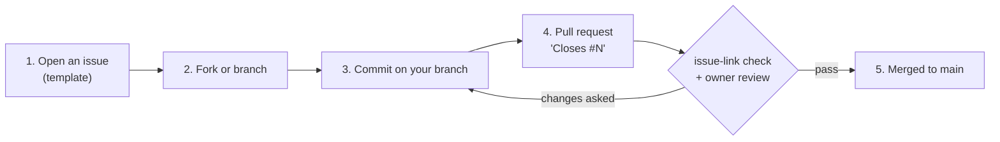

# Contributing

Thanks for helping. This project reverse-engineers the Kenwood TM-D710's firmware. [AGENTS.md](AGENTS.md) is the rule book for humans
and AI agents alike.

## How changes get in

1. **Every change starts with an issue** (correction, new analysis or tool, question).
2. **Every commit goes through a pull request.** Only the repository owner and admins push to `main` directly.
3. **Link the issue in the PR description** with `Closes #12`, `Fixes #12` or `Resolves #12`; the `issue-link` check fails without it.
4. **Review.** The repository owner reviews every pull request (`.github/CODEOWNERS`).

## What a good change looks like

- **Evidence tags.** Mark claims **[fact]** (with the address), **[inference]** or **[guess]**.
- **Figures.** Mermaid in Markdown, about 25 nodes or fewer.
- **Ghidra names.** Send `tools/ghidra/names_*.tsv` edits plus the `decomp/` re-export; Ghidra databases can't be merged.
- **Not in the repo:** firmware updaters, extracted images, manuals, Ghidra projects.
- **Don't touch someone's radio without asking.** Firmware updates, memory/menu writes and untested set-commands need that radio owner's
  explicit approval each time.
- **Licence conditions.** Changes that affect transmit (power, frequency limits) must keep the radio within its operator's licence.
